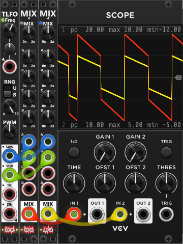

# Mixer modules
This section covers the dedicated mixer modules in Infinite-Noise—modules built for combining multiple signals into a mixed output. The Manual Mix 4 family currently provides mono and stereo four-input mixers with per-input gain, a master mix level, shared unity and averaging mix modes, and optional per-section inverted amplification. Mk I is fully manual; Mk II and Stereo add amplification CV inputs with chainable normalization. The two matrix mixers are [Matrix Mix 5x5](MatrixMix5x5.md) and [Matrix Mix 4x4 Stereo](MatrixMix4x4Stereo.md).

Beside these dedicated mixer modules linked below, a few [Tweak modules](commonTweak.md) also include averaging mix: [Tweak-2 Mk II](Tweak2II.md) (2 signals), [Tweak-4 Mk II](Tweak4II.md) (up to 4), and [Tweak-8](Tweak8.md) (up to 8). *One big difference between the Tweak modules with mixing capabilities and the mixers mentioned here is that the Tweak modules generate an averaging mix, whereas the mixers mentioned here generate a unity mix by default.*

All of the the mixers mentioned below can operate in **two distinct mix-modes** (however **defaults to unity mix**). A small **mix-mode button** sets the active mode (unpressed/black = Unity mix, pressed/blue = Averaging mix):
+ **Unity mix** (default): All inputs are simply summed (according to mix-knobs). So if only connecting inputs 1-3 the output will be as follows (I#=Input #, M#=Mix-knob #, and MM = Master mix-knob): `Output = (I1 x M1 + I2 x M2 + I3 x M3) x MM`. As you add/remove connections you typically need to adjust the master mix-knob. However even if you only mix in a fraction of some of the inputs, you should be able to reach the desired final output level. *Remember to disable/change the default +/-12V clipping if you plan to exceed this range for some reason.*
+ **Averaging mix**: All inputs are summed (according to mix-knobs) and then divided by the number of active inputs in use. So if only connecting inputs 1-3 the output will be as follows (I#=Input #, M#=Mix-knob #, and MM = Master mix-knob): `Output = ((I1 x M1 + I2 x M2 + I3 x M3) / 3) x MM`. The reason for the `/ 3` is because only 3 inputs are in use in this example. The benefit of the Averaging mix is that you typically don't need to make huge adjustments to master mix-level as you add/remove connections, but on the other hand if some of the inputs are very low, it can be hard to reach the desired final output level.

The screen-shot below illustrates the difference between a Unity- (red) and Averaging mix (yellow). The exact same Saw- (blue) and Square-waveform (green) are passed into 2 "Manuel Mix 4 Mk I" modules. The left is configured for unity mix (dim button next to the "MIX" label) and the right is configured for averaging mix (blue button). As all of the mix knobs are at 100% the unity mix is simply adding the two waveforms (red). The avering mix is using the exact same addition, however as there are 2 active inputs, it divide the summed signal by 2 (yellow):

When it comes to the **matrix mixer the avering mix-mode will behave a bit different** than when the Manual Mix modules are in averageing mix-mode. In averaging mix-mode the summed mix (basically the Unity mix) of the manual mix module is divided by the number of connected inputs. E.g. with 3 inputs connected and all mix knobs set to 1x, the avering mix will be the sum of the 3 inputs divided by 3. However for matrix mixers, the "count" (used for division) is based on inputs that actually are **included in each column mix**. Hence 3 things must be true for an input to "count":
+ The input port MUST have a cable connected.
+ The gain MUST be non-zero.
+ The send knob for that input, in that column MUST be non-zero.

If those 3 conditions are not true, the input row does not affect the mixed signal and therefore does not "count" as an active input. When you think about it, this distinction makes sense. The Manual Mix modules only produce a single mix, so if you connect 3 cables (input 3 signals), you do so because you want to mix those 3 signals. However, with a matrix mixer, you are producing multiple mixed outputs. So, you might connect 5 input signals on the left side of the module, but for the 1st column you might only mix 2 of those signals into its output. In the 2nd column, you might include 2 other inputs, while in the 3rd column you might mix in all 5 inputs.

Mixer modules: [Manuel Mix 4 Mk I](ManMix4I.md), [Manuel Mix 4 Mk II](ManMix4II.md), [Manuel Mix 4 Stereo](ManMix4st.md), [Matrix Mix 5x5](MatrixMix5x5.md), [Matrix Mix 4x4 Stereo](MatrixMix4x4Stereo.md).

[Go back to modules overview](plugin.md#modules)
