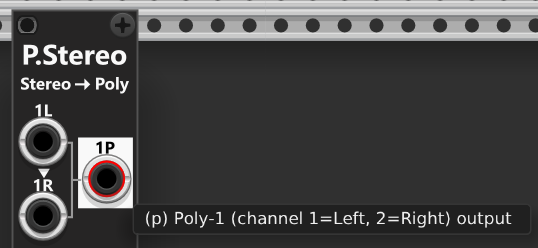
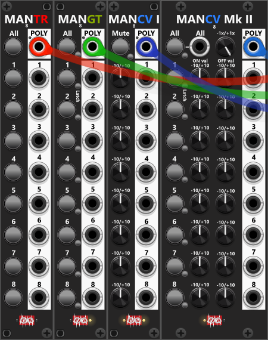

# Poly-tools
Simply looking at a Port in an Infinite-Noise module you can quickly distinguish monophonic- and polyphonic-ports, as polyphonic ports are displayed with a **thin red cicle** within the port. Hence ports without this red cicle are monophonic. It is however only possible to see the thin red circle when the port is not connected. As soon as you connect a cable to the port, the red cicle will be "hidden" behind the connected cable. For the same reason, hints for all monophonic/polyphonic-ports will be prefixed by either "**(m)**" or "**(p)**" to indicate whether the port is monophonic or polyphonic. *Whether this prefix should be shown or hidden can be controled via the "Global" context-menu.*

Most Infinite-Noise modules support polyphonic signals, however, some modules neither support nor generate polyphonic signals, which may require converting signals between polyphonic (multi-channel) and monophonic (single-channel) formats. To address this, the [Poly-Shuffle](PolyShuffle.md) module allows you to change the number of channels in a mono- or polyphonic signal. In addition, the [Poly-Split](PolySplit.md) and [Poly-Merge](PolyMerge.md) modules can be used to split and merge polyphonic/monophonic signals, or together function as a polyphonic patchbay—for example, by first splitting a polyphonic signal into individual monophonic/polyphonic signals and then reconstructing a new/differently arranged polyphonic signal. These tools provide seamless control over polyphonic signals, making it easy to split, merge, and manage multi-channel audio and CV data in your modular environment. Each module’s functionality is explained on its own page. 

**TIP**: Many modules are not specifically designed to handle stereo signals (separate left/right audio signals). For example, most of the [Switch-modules](commonSwitch.md) do not provide separate left/right inputs and outputs. However, since most Infinite-Noise modules support polyphonic signals, you can instead "encode" (merge) separate left/right audio signals into a 2 channel polyponic signal, and then pass on this signal to the intended module. Once processed you most likely will need to "decode" (split) this 2 channel polyphonic signal stereo signal into two separate (monophonic) left/right signals. [Poly-Stereo](PolyStereo.md) is build for this exact purpose, and can at the same time encode (top section) and decode (bottom section) 2 separate stereo signals *(what would otherwise require two Poly-Merge- and two Poly-Split modules to do the same)*.

Typically, a polyphonic splitter divides a polyphonic signal into multiple monophonic signals. Likewise, a polyphonic merger usually combines multiple monophonic signals into a single polyphonic signal. Out of the box, this is how Poly-Split and Poly-Merge operate in **Mono mode**. However, when switched to **Poly mode**, Poly-Split can split a polyphonic signal into multiple polyphonic signals—for example, splitting a 16-channel signal into two distinct 8-channel polyphonic signals. Similarly, in “Poly” mode, Poly-Merge can merge multiple polyphonic (and monophonic) signals into a single polyphonic signal—for example, combining two 8-channel polyphonic signals into one 16-channel polyphonic signal, where the first 8 channels come from the first signal and the remaining 8 channels come from the second signal.

## MAN-TR, MAN-GT, & MAN-CV8I/II
 
All 4 of these modules are described elsewhere ([Manual Controllers](commonManCV.md)) but I want to mention them in this section of the documentation as well, as they can be used to construct Polyphonic signals. All 4 of these modules have 8 separate sections with buttons or knobs that allows you to generate 8 district/monophonic signals each with either a fixed CV-signal (set by knobs in the range -10V to +10V), a gate or a trigger. However beside these 8 individual/monophonic outputs, these modules also feature a single **Poly** output in the top of the module. By default this polyphonic output will be an 8 channel signal, where each channel correspond to each of the 8 individual/monophonic outputs. However using the context menu, the number of channels can be reduced (e.g. only include the first 4 sections as a 4 channel polyphonic signal).

 

**TIP**: If you need to construct a signal with more than 8 channels, you can use 2 of the modules (e.g. 2 Man-CV8I modules), which each can output a 8-channel polyphonic signal. You then feed the first 8-channel signal into port-1 of a Poly-Merge in **Poly-mode**, and the other 8-channel signal into port-9 of the same Poly-merge, and set the Poly-merge to output 16 channels.

Poly-tool modules: [Poly-Merge](PolyMerge.md), [Poly-Split](PolySplit.md), [Poly-Stereo](PolyStereo.md), [Poly-Quad](PolyQuad.md), [Poly-Shuffle](PolyShuffle.md), [Poly-Tweak Mk I](PolyTweakI.md), [Poly-Tweak Mk II](PolyTweakII.md), [Poly-Logical Compare](PolyLCMP.md), [Poly-Value Compare](PolyVCMP.md), [Poly-Offset](PolyOffset.md), [Poly-Scale](PolyScale.md).

[Go back to modules overview](plugin.md#modules)
