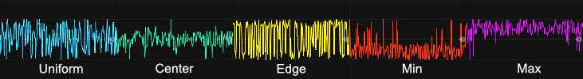

# Random modules
The Infinite-Noise plugin includes several modules capable of generating random outputs or using internal randomization. If you need a simple bipolar/unipolar random value, the [S&H, T&H and H&T modules](commonShth.md) are ideal choices, especially the SHTH2 module, which has a built-in LFO that generates a random value from an internal noise source each time its phase restarts. Similarly, the [Bernoulli Switch](BernoulliSwitch.md) allows you to set a probability for routing signals between two inputs and one output ("A/B->") or one input and two outputs ("->A/B"). If no input is used, the "A/B->" section can even be used to generate random gates (high=10V, low=0V) based on the probability setting.

However, there are cases where more advanced randomization is needed. The Random-4 and Random-Curve modules allow for customizable random values with defined ranges and distributions. Random-4 outputs four random values at once when triggered, while Random-Curve continuously generates smooth curves that transition between random values.

### Frequency (how often random-values are generated)
Both Random-4 and Random-Curve can generate random values based on:

+ An internal LFO (interval set by a frequency knob, affected by Rate Chaos)
+ External modulation (CV-input for frequency in Random-Curve, trigger input in Random-4)

When using the internal LFO, the context menu offers a **Rate Chaos** setting that randomizes the speed of each individual cycle, so new random values are generated at slightly - or wildly - irregular intervals instead of at a perfectly steady rate. This option appears on several other modules too and is described in the [main manual](commonFeatures.md#rate-chaos).

### Range in which random values are being generate
The range of random values is set by a range-size knob and an offset point (anchor). The range can be adjusted from 0V to 10V. The offset point determines whether the range is centered (default) or defined from a minimum- or maximum-value. On Random-Curve, you can toggle the offset point using a button. On Random-4, it must be set via the context menu. Random-Curve also has a CV input for dynamic range adjustments.

**TIP**: Although the range knob is limited to 0V-10V, Random-Curve allows external CV control of the range, e.g. adding another 10V. This means the effective range can extend to 20V, e.g. covering values from -10V to +10V if needed. As an alternative you can use a [Tweak-2 Mk I](Tweak2I.md) to scale the output all the way up to 10x (or simply 2x to expand a ±5V range to a ±10V range).

### Distribution of generated values
By default, the generated random values are uniformly distributed (white noise), meaning any value within the range has an equal probability of occurring. However, you can modify this distribution to favor certain values using the distribution knob. The modules offers two distribution modes:

**Center/Edge Mode** (Default)
+ Counterclockwise: Increases the probability of values appearing near the center of the range.
+ Clockwise: Increases the probability of values appearing near the edges (both min and max).

**Min/Max Mode**
+ Counterclockwise: Increases the probability of values being closer to the minimum.
+ Clockwise: Increases the probability of values being closer to the maximum.

A green indicator light will show which mode is active. The distribution knob ranges from -1 to +1, where the range starts to "collaps" when going beyond ±0.6. If turned fully to -1 or +1, the entire range fully collapses to a value at the minimum, center, or maximum.

The Distribution knob ("+ CV input / 5") operate within a range of -1 to +1. However, with the default scaling, significant changes in distribution become noticeable when the knob is turned beyond -0.6 or +0.6. If the knob is fully rotated to -1 or +1, it effectively fully collapses the range of random values into a single fixed value—either the minimum, center, or maximum, depending on the selected settings. To maintain a full range of random values, it is **recommended to keep the knob within the -0.6 to +0.6 range**. 

However, instead of requiring manual precision, the context menu provides an option to adjust the internal scaling of the knob in 5% increments, from 60% to 100%. This allows the knob to be rotated fully without unintentionally limiting the generated values. For instance, setting the scaling to 60% enables full-range knob movement while still preserving the full range of random values. A small blue indicator light next to the "Dist" label provides a visual cue when scaling is below 100%. The lower the scaling, the brighter the light appears. At 60% scaling, the light is fully illuminated, while at 100%, it remains dimmed. This provides an intuitive way to check whether scaling has been reduced and by how much.

The illustration below shows 5 different sets of distributions (each using a different graph-color). The 1st (left-most) graph shows a default uniform distribution where there is equal change of all generate values between min and max. The remaining 4 graphs shows specific selected distributions. In all 4 cases the distribution setting were set in the ±0.6 range, to ensure random outputs in the full range were still possible, however there would be a higher chance for some values being generated more often than others.

 

**TIP**: Using a center-weighted distribution, where random values are more likely to be generated near the middle of the defined range, combined with quantized output (enabled via the context menu), can be an excellent way to generate random musical notes in a 1V/Oct format. Alternatively, the output can be routed to a dedicated quantizer module to fit a specific scale, key, or set of notes. For example, if you set the center of the range to match the voltage of your desired root note and define a range of 2V, the module will generate values corresponding to musical notes that span up to one octave above and below the root note. Since the distribution is biased toward the center, there is a higher probability that the generated notes will be closer to the root note and a lower chance of selecting notes at the upper or lower extremes of the specified range. 

**TIP**: By selecting a max- or min-weighted distribution, you can bias the generated values toward either the upper or lower end of the range. This can be especially useful for modulating filter parameters, such as cutoff frequency or resonance, allowing you to control the probability  that the filter opens or closes. 

Likewise all of the Infinite-Noise modules by default treat values at/above 1V as a high gate, meaning without any special distribution there is a 40% chance a random bipolar value is detected as a high-gate (>=+1V to +5V), while there is a 60% chance it will be detected as a low-gate (-5V to <+1V). Using a max-weighted distribution you can increase the chance that generated output will be detected as a high-gate, and likewise using a min-weighted distribution you can increase the chance that generated output will be detected as a low-gate. *As an alternative you can use a [Tweak-2 Mk I](Tweak2I.md) to offset the output, to increase/descrease chance of output being detected as a high-gate (but this would require an extra module compared to just change distribution).*

### Forced Polarity
When the distribution mode is set to **Center/Edge**, you have the option to enable "Forced Polarity". In the Random-Curve module, this is controlled via a small "FP" button above the Dist knob, while in the Random-4 module, it must be activated through the context menu. When **Forced Polarity is enabled**, the generated values will alternate between the upper half and lower half of the defined range. For example, with the default range from -5V to +5V, every second value will be positive (0V to +5V), while the others will be negative (-0V to -5V). This creates a more dynamic movement in the generated values, particularly useful when using the Random-Curve module to generate smoothly transitioning random curves, as it will then alter between rising- and falling curves.

**Note**: Forced Polarity is ignored when the distribution mode is set to "Min/Max".

Random modules: [Random-4](Random4.md), [Random Curve](RandomCurve.md), [Chaos](Chaos.md).

[Go back to modules overview](plugin.md#modules)
