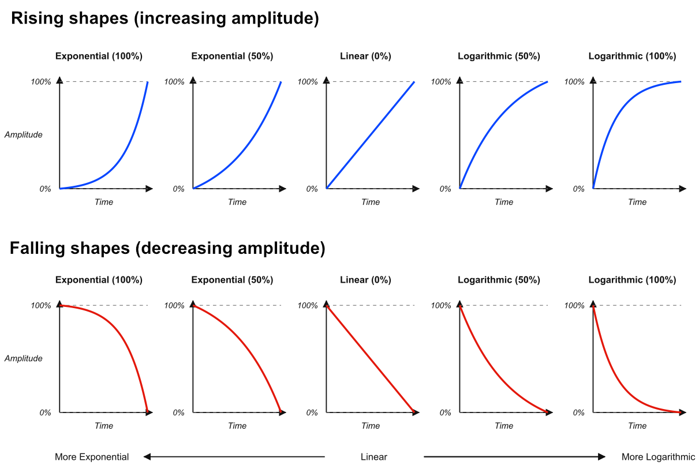

# Slew
The Infinite-Noise slew modules lag an input toward its current voltage, either using constant rate (default) or constant time (selected via context menu). Rise and fall can take different times, and the curve can be exponential, linear, or logarithmic. *The logarithmic curve is actually an inverted exponential in order to generate a "symetrical" output. Via the context menu the linear can be changed to S-curve or reversed S-curve.*

**Time** knobs will by default set a rate of **seconds to move 10 V**. A 10 V step still takes that time at any Shape; Shape only bends the slope. Linearly, a 5 V jump takes half as long as a 10 V jump. Times use **quadratic** knob mapping (knob² × max): default is **0** (pass-through), noon is 2.5 s, and fully clockwise is 10 s. **0 is pass-through**: the output follows the input immediately. A **Time scale** of 0.1× / 1× / 10× stretches that max to 1 / 10 / 100 s without moving the knobs. On Slew 4 the scale is a context-menu item, and tiny lights at the top-right of the Rise and Fall knobs show it: **green** = 0.1×, **off** = 1× (default), **red** = 10×. Slew 2 uses the same colours on a panel button instead of a menu, where the button cycles the 3 different modes.

The slew modules defaults to **Constant Rate**, where the time dialed in by the rise/fall time knobs defines the time a 10V change will take (e.g. from 0V to 10V, or from -5V to +5V). However using the context menu the **Slew-mode** can be changed to **Constant Time**. In this mode the time knobs in stead defines the time any change will take. *Tiny changes (under about a millivolt) do not restart the slew; only a clearer step toward a new level does.* Next to each time-knob there is a small light which indicate the active slew-mode selected via the context menu (dim=constant rate, blue=constant time).

**TIP**: A constant rate slew is more commonly used, hence why it's the default mode. However **a constant time slew can be used for many different things**, but one typical usage is **Glide/Glissando**. Here the slew time would be the same whether you slew from **C3 to G3** or you slew from **C3 to C4**. Since the clock used by a squencer is typical fixed, the various outputs of the sequencer also tend to change at a "fixed rated". So if you want to slew the outputs of the sequencer (not necessarily only the V/OCT-output), you might prefer using a constant slew time over a constant slew rate, as this would ensure each slew will take the same time, no matter how far you have to slew between changes (e.g. ensure each slew will finish before the next clock starts, which might change the sequencer output).

The **shape** knob is −1 to +1. Center (0) is **linear** (but can also be **S-Curve** - see below). Turn counterclockwise for **exponential**, clockwise for **logarithmic**. An **exponential rise/fall** starts slow and steepens toward the target. A **logarithmic rise/fall** does the opposite (fast then slow). The illustration below shows 100% / 50% exponential, linear, and 50% / 100% logarithmic in both directions. The logarithmic shape is actually an inverted exponential shape, so the two remain symmetrical. The exact same shapes are utilitzed by [ADR Envelope](ADREnvelope.md) and [ADSDR Envelope](ADSDREnvelope.md).

When the Shape knob is centered, the slew will be linear by default. However, via the context menu, you can change the **Linear-mode** to **S-Curve** (slow at the start -> fast in the middle -> slow at the end) or **Reversed S-curve** (fast at the start -> slow in the middle -> fast at the end). The S-curve shape can generate smooth curves when you have dialed in a slew time that matches the frequency at which the input changes (hence perhaps "best" when using **Constant time** slew-mode). The reversed S-curve on the other hand will generate output which will look like the "Spiky" output of a [Random Curve](RandomCurve.md) module. When S-curve or reversed S-Curve is enabled, you can still turn the Shape knob clockwise (exponential) or counterclockwise (logarithmic). If you don't turn the Shape knob fully, the S-curve/reversed S-curve will be mixed into the exponential/logarithmic shape.

**TIP**: Patch a gate through Slew 2/4 into a [cross-fade](commonCrossFade.md) CV input for a time-driven fade. Rise/Fall set how long the fade takes; Shape sets how it eases.

Slew modules: [Slew 2](Slew2.md), [Slew 4](Slew4.md).

[Go back to modules overview](plugin.md#modules)
