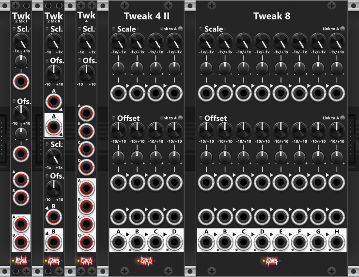

# Tweak modules
All Tweak modules share a common set of features, making them an essential part (at least in my own racks). These modules allow for **scaling** (attenuverting between -1x and +1x, or up to -10x/+10x using the Scale-range button), **offsetting** (-10V to +10V), **clipping**, **quantization**, and **mixing** signals (except for Tweak-2I, and Tweak4I which cannot mix). When first added to a rack, each module is initialized with default settings: scaling set to 1x, scaling mode set to linear, offset set to 0V, and perform scaling before offset. This means the output will initially be identical to the input signal. 

To keep the panel uncluttered, clipping and quantization settings are only accessible through the context menu. By default, all outputs are hard-clipped at -12V to +12V, but this range can be adjusted or disabled. Quantization is off by default but can be enabled via the context menu. Available quantization options include 1/12V (for semitones/notes), multiple semitone steps, whole octaves (1V), or multiple octaves.

The scale knobs allow for attenuverting between -1x and +1x by default, but this can be expanded using the **Scale-range** button to the left of the Scale label. Click the button to cycle through 1x, 2x, 5x, and 10x. The label on the physical panel always shows "-1x" to "+1x", but the button color reflects the active range:

+ **1x**: Black/dim (default)
+ **2x**: Green
+ **5x**: Yellow
+ **10x**: Red

In 1x mode, the scale knob adjusts from -1x (-100%) to +1x (+100%), while in 10x mode, it spans -10x (-1000%) to +10x (+1000%). If you plan to output signals beyond ±12V, **ensure that clipping is disabled** in the context menu, otherwise with the default settings the signal will be clipped to the range -12V to +12V.

Some Tweak modules include a CV input for controlling the scale parameter. This CV input value is added to the manual scale setting, but the total scaling remains clamped within the selected Scale Range Mode. By default, the scaling is linear, but it can be adjusted via the context menu to Exp (green) or Log (red). This light is dimmed when using default linear scaling.

**TIP**: If you need to multiply two signals (e.g., mixing two LFO outputs), it's advisable to keep their amplitudes within -1V to +1V (bipolar) or 0V to 1V (unipolar) to ensure the product remains within the same range (or at least keep one of the signals within this range). The 5x and 10x modes of the Tweak modules are particularly useful for scaling signals: To amplify a bipolar signal (-1V to +1V) to -5V to +5V, using 5x mode, and to amplify a unipolar signal (0V to 1V) to 0V to 10V, using 10x mode.

In terms of **polyphony**, only Tweak-2I, Tweak-2II, and Tweak-4 Mk I support polyphonic signals, and will output as many channels as you input. In Tweak-2II when mixing the A- and B-output, it will always match the number of channels from the input with the highest channel count. For example, if a 4-channel signal is fed into the A-input and an 8-channel signal into the B-input (without connecting a cable to the A-output), the B-output will produce an 8-channel polyphonic signal, with the additional 4 channels from B mixed with 0V. For optimal results when mixing two signals, both should ideally have the same number of channels. However, if one input is monophonic, its signal will be automatically applied across all channels of the polyphonic signal. 

Tweak-2I offer CV-input for both Scale and offset. This input both support monophonic- and polyphonic-signals. When you input a monophonic CV-signal all channels will be scaled/offset by the same amount, however if you input a polyphonic signal, you are able to scale/offset individual channels by different amount.

 

As seen in the previous screenshot, the Tweak modules come in multiple versions, each differing in the number of sections, whether scale and offset settings are applied individually per section or shared across multiple sections, and whether adjustments can be made using CV inputs or only through knobs. All modules allow for scaling (attenuverting/amplifying) and offsetting the input signal. By default, the **scale operation is performed before the offset operation**, but this **order can be changed** using the **Order** button to the left of the Offset label. When the button is unlit, the default "Scale → Offset" order is active. Click it to switch to "Offset → Scale" (blue), so offsetting occurs before scaling.

Among the Tweak modules, Tweak-2I, and Tweak-4I are the only one that does not support mixing signals. The other modules, such as Tweak-2II, Tweak-4II and Tweak-8, allow for mixing. Tweak-2II has two sections labeled A and B, and if no cable is inserted into the A-output, the B-output will contain a normalized mix of both sections—effectively averaging their signals. For dedicated mixers without scale/offset (Manual Mix 4 Mk I, Mk II, and Stereo), see the [Mixer modules](commonMixer.md).

## How does the mix-operation work
For a section to be included in the mix operation, it must have an input cable connected. If no input is present, any previously accumulated mix values will be cleared. The first active output (connected to both an input and output cable) will generate a mix of its own section along with all preceding sections that also have an input cable connected (but no outputs). However, if a section lacks an input or has an output connected, the accumulated mix is reset, starting "a new mix" at the next active section. The actual output level of the mix is determined by summing all included sections and dividing by the number of sections in the mix. Small green lights next to each output (except for the A-output) indicate when a port is outputting a mix of two or more inputs.

The actual generated mix is an **averaging mix** as it typical don't need a lot of scale-reduction as additional signals are added to the mix (or scale-increase when signals are removed from the mix). In an averaging mix all signals are added, and the divided by the number of inputs. E.g. mixing the signals 1V, 2V and 3V will generate and output of 2V ("(1+2+3)/3=2").

If needed, **mix mode can be disabled** via the context menu. For example, in Tweak-2, when both A and B inputs and outputs are connected, each output will independently process its corresponding input (A-output will only output the tweaked A-input, and B-output will only output the tweaked B-input). However, if the A-output is disconnected, the B-output will start outputting a mix of both A and B inputs (indicated by the lit green light next to the B-output). If you prefer the B-output to remain independent, you can disable mix mode in the context menu, ensuring that the B-output only processes the B-input, regardless of whether the A-input remains connected. When mix mode is disabled, the green light will remain off, indicating that the output is not mixing multiple signals.

### A few mix-examples (Mix-mode enabled)
Below are 3 examples to better illustrate how the mix of signals are functioning:

+ **Example-1**: In a scenario we will use a Tweak 4 Mk II (or Tweak 8) where four sections (A, B, C, and D) each have an input connected, but only B and D have an output cable. The B-output will mix A and B (sum divided by 2), while the D-output will mix C and D (also sum divided by 2). Each mixed value is calculated after applying individual scale and offset settings. For instance, if A-input = 1V, A-offset = +4V, and B-input = 3V (with no offset), the output at B will be 4V: (1+4+3)/2.
+ **Example-2**: If inputs are connected to A, B, C, and D, but only C and D have outputs, the C-output will mix A, B, and C (sum divided by 3), while the D-output will process only the D-input since the accumulated mix is reset at section C.
+ **Example-3**: In another case, where inputs are connected to A, B, and D (but not C), and only D has an output, the absence of an input at C "clears the mix of A and B", resulting in the D-output containing only the processed D-input. Additionally, since C lacks an input, it normalizes to the previous input (B). If an output is connected to C, it will clear the accumulated mix and output only the normalized B-input.

**TIP**: A module designed to scale and offset signals has a wide range of practical applications. At its simplest, you can use the offset knobs alone to generate fixed voltage outputs ranging from -10V to +10V without requiring an input signal. Many modules for VCV Rack lack built-in controls for attenuverting CV inputs, so passing the signal through a tweak module beforehand allows for precise control over scaling and offsetting. For example, if a module generates an unipolar envelope ranging from 0V to 10V, and you want to invert it — so that an input of 7V becomes 3V, and an input of 2V becomes 8V — you can set the scale to -1x (which inverts 7V to -7V) and then apply an offset of +10V (shifting it to +3V). This effectively flips the envelope while keeping the output within the desired 0V to 10V range. If a different range is needed, such as 0V to 5V, setting the scale to -0.5x and the offset to +5V will achieve that result.

**TIP**: Similarly, a tweak module can be used to refine the output of a random signal generator, limiting its range to a specific voltage window before passing it on. Additionally, the module’s quantization feature can be used to convert a smooth random signal into quantized note values, making it suitable for melodic sequencing before being sent to an oscillator—potentially via a Sample-and-Hold module. The quantization function is not limited to pitch control; any continuously varying signal can be transformed into a "stepped waveform" with fixed interval steps. By enabling quantization, the output signal will adopt a stair-stepped pattern with 12 steps per volt (or other selected increments), which can be adjusted via the context menu.

Tweak modules: [Tweak-2 Mk I](Tweak2I.md), [Tweak-2 Mk II](Tweak2II.md), [Tweak-4 Mk I](Tweak4I.md), [Tweak-4 Mk II](Tweak4II.md), [Tweak-8](Tweak8.md).

[Go back to modules overview](plugin.md#modules)
