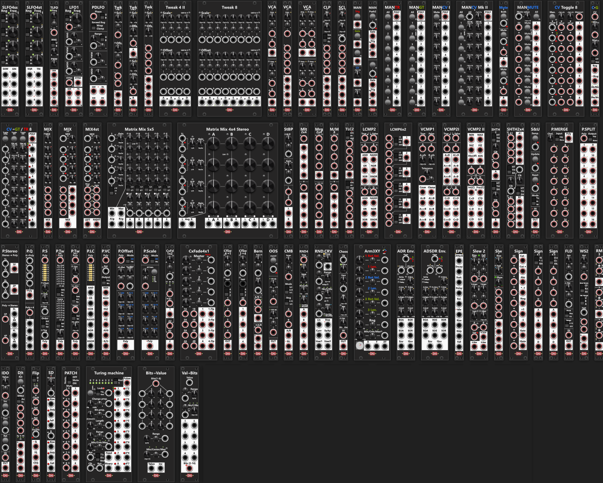

# Infinite-Noise rack modules - Manual
**If this is your first visit to this manual I suggest you begin by looking at [Common Features](commonFeatures.md)** which describes features that are common to all Infinite-Noise modules. Below you find a complete list of all modules along with a short description of that module and a link to a dedicated manual page for that module.

# Modules
Many modules include a number in their name (e.g., "Manuel Trigger 8" or "Auto-Scale 4"). This number typically indicates how many "sections" the module has, which determines how many different signals can be processed simultaneously. Typically a single module which can process multiple sections (thereby multiple signals) at the same time, is more efficient than using multiple modules which each only process a single signal. A few of the modules comes in Mk I and Mk II versions, where these modules are similar, but still different. E.g. one might only have knobs, whereas the other both support knobs and CV-input and/or one might have a single set of knob/cv-controls affecting all sections, and the other might have individual knob/cv-controls for each section. *Some of the modules "belongs to a familiy of similar modules", and beside the single manual page for each module, they might have a link to a common manual page with some common info. E.g. [Common LFO features](commonLFO.md) describes what is common between the LFO modules (in stead of repeating the same "common stuff" for all LFO modules).*

## LFOs
+ [Simple LFO4-ss](SLFO4ss.md): 4HP quad LFO: four independent knob-set rates, Saw and Sine per LFO, internal hard/soft sync, Rate Chaos, and uni/bipolar range.
+ [Simple LFO4-st](SLFO4st.md): 4HP quad LFO: four independent knob-set rates, Square and Triangle per LFO, internal hard/soft sync, Rate Chaos, and uni/bipolar range.
+ [Tiny LFO](TLFO.md): 2HP Tiny LFO with knob/CV rate, PWM, Rate Chaos, and uni/bipolar range. Outputs Saw, Square, Triangle and Sine (polyphonic).
+ [LFO1](LFO1.md): 4HP LFO with knob/CV rate, PWM, MOD, external sync in/out, n-shot, Rate Chaos, and uni/bipolar range. Outputs Saw, Square, Triangle and Sine (polyphonic). Square+MOD acts as a wavetable (Triangle <-> Square <-> Saw).
+ [Phase-Driven LFO](PhaseDrivenLFO.md): 4HP phase-driven LFO: incoming phase CV sets the waveform (no internal oscillator). PWM, MOD, wrap, and uni/bipolar range. Outputs Saw, Square, Triangle and Sine (polyphonic).

## Tweak (attenuate/amplify, offset and mix)
+ [Tweak-2 Mk I](Tweak2I.md): 2HP dual attenuverter: shared knob/CV scale (1x, 2x, 5x, 10x) and offset. Polyphonic, quantize, stereo-friendly. No mix.
+ [Tweak-2 Mk II](Tweak2II.md): 2HP dual attenuverter: individual knob scale (1x, 2x, 5x, 10x) and offset, plus averaging mix. Polyphonic, quantize. Optional A/B link.
+ [Tweak-4 Mk I](Tweak4I.md): 2HP quad attenuverter: shared knob scale (1x, 2x, 5x, 10x) and offset across four signals. Polyphonic, quantize. No mix.
+ [Tweak-4 Mk II](Tweak4II.md): 7HP quad attenuverter: individual knob/CV scale (1x, 2x, 5x, 10x) and offset, plus averaging mix. Quantize, optional link-to-A.
+ [Tweak-8](Tweak8.md): 14HP 8-section attenuverter: individual knob/CV scale (1x, 2x, 5x, 10x) and offset, plus averaging mix. Quantize, optional link-to-A.
+ [VCA-2](VCA2.md): 2HP dual VCA: independent knob/CV gain (0-100%) per section. Polyphonic, lin/exp/log, optional A/B link.
+ [VCA-4 Mk I](VCA4I.md): 2HP quad VCA: shared knob/CV gain (0-100%) across four signals. Polyphonic, lin/exp/log.
+ [VCA-4 Mk II](VCA4II.md): 4HP quad VCA: independent knob/CV gain (0-100%) per section. Polyphonic, lin/exp/log, optional A/B, B/C and/or C/D link.
+ [Flux 4](Flux4.md#flux-4): 10HP quad morphing VCA: Pos, Range and Sweep shape four signals, with optional linked ranges and A+B, C+D, min, max, average and sum outputs.
+ [Clamp 4](Clamp4.md): 2HP quad clamp: min/max range with invert, plus Diff and Gate modes. Polyphonic, optional 2x oversampling, min/max link.
+ [Auto-Scale 4](AutoScale4.md): 2HP quad auto-scale: fits each input into a min/max range (with invert). Polyphonic, reset, lock, min/max link.

## Controllers/converters
+ [Manuel Trigger, Gate and CV](ManTrGtCv.md): 2HP performance controller: 1 trigger, 2 latchable gates, and 2 CV knobs (-10V to +10V). Polyphonic, CV quantize.
+ [Manuel Push 2](ManPush2.md): 2HP dual controller: latchable buttons with gate and high/low trigger outputs, plus CV in. Converts gates to triggers (or vice versa).
+ [Manuel Trigger 8](ManTrigger8.md): 4HP controller: 8 momentary trigger buttons, All, and a polyphonic output.
+ [Manuel Gate 8](ManGate8.md): 4HP controller: 8 latchable gate buttons, All, and a polyphonic output.
+ [Manuel CV 8 Mk I](ManCV8I.md): 4HP controller: 8 CV knobs (-10V to +10V), mute, and a polyphonic output. Quantize.
+ [Manuel CV 8 Mk II](ManCV8II.md): 8HP controller: 8 On/Off CV pairs with toggle buttons, All, attenuate, and a polyphonic output. Quantize.
+ [Manuel Mute 8](ManMute8.md): 6HP 8-channel mute: per-section buttons and CV, All, latch, and a mute-value knob/CV.
+ [Mute 2](Mute2.md): 2HP dual mute: per-section latchable button and gate/trigger CV, plus Both.
+ [CV-Toggle 8](CvToggle8.md): 8HP 8-section On/Off switch: CV or knob values, gate/trigger per section, All, and attenuate.
+ [CV to Gate](CvToGt.md#cv-to-gate): 2HP fire a gate if CV is within a specified min/max range. Also above, below, inverted-range, and Diff.
+ [CV to Gate/Trigger 8](CvToGtTr8.md#cv-to-gatetrigger-8): 8HP 8 sections can fire a gate or trigger if CV is within a specified min/max range. E.g., you can input a single CV signal and have up to 8 gate/trigger outputs that can fire independently based on the value of the CV input.

## Mixers
+ [Manuel Mix 4 Mk I](ManMix4I.md): 2HP mixer: 4 inputs, per-input knobs (0-200%), master, unity or averaging mix.
+ [Manuel Mix 4 Mk II](ManMix4II.md): 4HP mixer: 4 inputs, per-input knob/CV (0-200%), individual outputs plus mix, unity or averaging.
+ [Manuel Mix 4 Stereo](ManMix4st.md): 4HP stereo mixer: 4 stereo inputs, per-input knob/CV (0-200%), stereo mix, unity or averaging. Optional mono-to-stereo.
+ [Matrix Mix 5x5](MatrixMix5x5.md): 14HP mono 5x5 matrix mixer: per-row invert/gain, linked column sends, per-column unity or averaging mix, range 0–1x or ±1x, level CV/trim, Min/Max/NtZ/FfZ/Avg/Rng.
+ [Matrix Mix 4x4 Stereo](MatrixMix4x4Stereo.md): 22HP stereo 4x4 matrix mixer: per-row L/R norm, balance/pan, gain, linked unipolar sends, per-column unity or averaging mix, L/R level lights, and Avg outputs.
+ [Stereo Balance/Pan](StereoBalancePan.md#stereo-balance-pan): 2HP stereo balance/pan with post gain 0–200%, CV/trim, and L/R level lights. Polyphonic audio; Right input normalizes from Left.

## Merge/Mult
+ [Mult2x4](Mult2x4.md): 2HP dual mult: two inputs with four copies each, or 1-to-8 if the lower input is unused.
+ [Merge2x4](Merge2x4.md): 2HP dual merge: two 4-to-1 sections, sum or averaging mix, with optional negative-value handling.
+ [Merge/Mult-4](MergeMult4.md): 2HP merge/mult: 4-to-1 sum or averaging mix, plus a 1-to-4 copy. Mult defaults to the merge.

## Logic/Value-compare
+ [Tiny Logic Comparator-2](TinyLCMP2.md): 2HP dual logic: 4 inputs per section, AND/OR/XOR with invert (NAND/NOR/XNOR). Inputs can be inverted individually via context menu.
+ [Logic Comparator-2](LCMP2.md): 4HP dual logic: all six Boolean outputs per section, plus True/False switch inputs. Buttons next to each input can invert the input individually.
+ [Logic Comparator-6x2](LCMP6x2.md): 6HP 6-section logic: 2 inputs each, AND/OR/XOR with invert (NAND/NOR/XNOR). Chainable. Inputs can be inverted individually via context menu.
+ [Value Comparator-1](VCMP1.md): 4HP value compare: A=B, A!=B, A>=B, A>B, A<=B, A<B, with tolerance, A/B-cross trigger, and clamp. True/False switch.
+ [Value Comparator-2 Mk I](VCMP2I.md): 4HP dual value compare: two sections of A=B, A!=B, A>=B, A>B, A<=B, A<B, with True/False switch inputs.
+ [Value Comparator-2 Mk II](VCMP2II.md): 4HP value compare and math: Min, Max, NtZ, FfZ, Abs-diff, and Avg of A/B, and Int/Frac of C and Plus, Minus, Mul, Div of C/D.

## S&H, T&H, H&T
+ [S&H/T&H-2](SHTH2.md): 2HP dual S&H/T&H/H&T: one in/out per section, clock in or internal LFO, Rate Chaos. Internal noise if unpatched.
+ [S&H/T&H-2x4](SHTH2x4.md): 4HP dual S&H/T&H/H&T: four in/out per section, clock in or internal LFO, Rate Chaos. Internal noise if unpatched. A clock normalizes to B.
+ [Sample and Update](SampleAndUpdate.md): 2HP sample-and-update: Sample, Update, and Reset via button/CV. Can also count triggers and fire one when the desired count is reached.
+ [Stack](Stack.md): 2HP polyphonic stack: push up to 16 values, pop FIFO or LIFO, and set how many of the newest items are accessible.
+ [Stack Expander](StackExpander.md): 2HP expander for Stack: Cycle the accessible stack-items to a Value output, with triger-overflow, underflow outputs, and gate-full, and empty outputs.
+ [Stack Bank Expander](StackBankExpander.md): 2HP expander for Stack: Four banks (stacks). Cycle among them, send a bank into Stack, or retrieve a bank from Stack.

## Polyphonic-tools
+ [Poly-Merge](PolyMerge.md): 6HP merge: up to 16 monophonic signals (or multiple polyphonic signals) into one polyphonic output. Channel count, Mono/Poly mode.
+ [Poly-Split](PolySplit.md): 4HP split: a polyphonic signal into up to 16 monophonic signals (or multiple polyphonic signals). Mono/Poly mode.
+ [Poly-Stereo](PolyStereo.md): 4HP encode/decode: two mono left/right pairs to/from 2-channel polyphonic stereo. If only left is connected, right copies it.
+ [Poly-Quad](PolyQuad.md): 2HP 4-channel merge/split: encode up to 4 mono signals into poly, and decode poly back to 4 mono. Auto packing or fixed count.
+ [Poly-Shuffle](PolyShuffle.md): 2HP add, repeat, or remove channels of a polyphonic signal. Also next, prev, or shuffle channel order.
+ [Poly-Tweak Mk I](PolyTweakI.md): 2HP invert/disable (mute/remove) poly channels via buttons. Can also construct a polyphonic signal with up to 16 gates.
+ [Poly-Tweak Mk II](PolyTweakII.md): 2HP invert/disable (mute/remove) poly channels based on CV-inputs. Can also mix individual channels of two polyphonic signals.
+ [Poly-Logical Compare](PolyLCMP.md): 2HP logical compare (AND, OR, XOR, NAND, NOR, XNOR) across all channels of one polyphonic signal.
+ [Poly-Value Compare](PolyVCMP.md): 2HP value compare (MIN, MAX, NtZ, FfZ, AVG, R/S) across all channels of one polyphonic signal. Can also monitor since last reset, all channels or per channel.
+ [Poly-Offset](PolyOffset.md): 4HP offset individual or group of channels of a polyphonic signal. All offset, incremental offset, and 8 knobs.
+ [Poly-Scale](PolyScale.md): 4HP scale (attenuvert/amplify) individual or group of channels of a polyphonic signal. All scale, 8 knobs, 1x/2x/5x/10x.

## Cross-fade and Switch modules
+ [Cross-fade 1x2](CxFade1x2.md): 2HP cross-fade a stereo signal, or two separate mono signals, by knob/CV. A/B toggle, trigger mode, panning, timed fade.
+ [Cross-fade 4x1](CxFade4x1.md): 8HP cross-fade 4 separate signals by per-section and master knob/CV. A/B toggle, trigger mode, flipped outputs, timed fade.
+ [Cross-fade switch 4to1](CrossFadeSwitch4to1.md): 2HP cross-fade/switch up to 4 inputs into 1 output. Knob/CV, trigger order, 2/3/4 ports.
+ [Cross-fade switch 1to4](CrossFadeSwitch1to4.md): 2HP cross-fade/switch 1 input into up to 4 outputs. Knob/CV, trigger order, 2/3/4 ports.
+ [Bernoulli Switch](BernoulliSwitch.md): 2HP Bernoulli switch with A/B-> (2 in, 1 out) and ->A/B (1 in, 2 out). Probability, clock in or internal LFO, Rate Chaos, fade.
+ [ON/OFF Switch](OnOffSwitch.md): 2HP switch between the ON- or OFF-signal via button, gate, or trigger. Knob/CV per state, fade.
+ [Combine](Combine.md): 2HP combine (switch) 2 inputs: Upper/Lower, A greater than B, or Rise/Fall. Knob/CV param, gate out.

## Random
+ [Random-4](Random4.md): 2HP generates 4 random (polyphonic) values within specified range with center/edge or min/max distribution at each trigger or internal LFO. Rate Chaos, slew.
+ [Random Curve](RandomCurve.md): 4HP generates 6 shaped random curves within specified range with center/edge or min/max distribution. Internal LFO, Rate Chaos, quantize.
+ [Chaos](Chaos.md): 2HP adds random chaos to an input (or outputs chaos). Range, distribution, slew, Rate Chaos.
+ [Arm 3 XY](Arm3XY.md#arm-3-xy): 8HP length and rotation of 3 arms (basically 3 polar vectors) generate a semi-random X/Y curve, plus XY mix. Individual Rate Chaos can be applied to length and/or rotational velocity of each arm.

## Envelope
+ [ADR Envelope](ADREnvelope.md): 4HP Attack-Delay-Release envelope with attack/release time and shape (technically Attack-Sustain-Delay-Release). Rate Chaos can affect each time-setting, changed at each cycle.
+ [ADSDR Envelope](ADSDREnvelope.md): 6HP Attack-Decay-Sustain-Delay-Release envelope with attack/decay/release time and shape, and levels for Attack, Sustain and Release. Rate Chaos can affect each time-setting, changed at each cycle.
+ [Envelope Phase Expander](EnvelopePhaseExpander.md): 2HP expander for ADR/ADSDR: phase gates (Attack, Decay, Sustain, Delay, Release, Idle) plus Rise, Steady, Fall. Idle can output phase position (0V to 10V).

## Slew
+ [Slew 2](Slew2.md): 4HP dual polyphonic constant rate/time slew with knobs and (polyphonic) CV/trim for rise and fall time and shape, Snap (gate/trigger), B-Catch (gate) output, shared Scale/Offset of the input, and envelope follower. Via context-menu the (center) linear shape, can be replaced by an S-Curve shape.
+ [Slew 4](Slew4.md): 2HP quad polyphoinc constant rate/time slew with knobs based rise/fall times/shape settings. Via context-menu the (center) linear shape, can be replaced by an S-Curve shape.

## Misc
+ [Delay 3](Delay3.md#delay-3): 2HP 3-section polyphonic delay (1–16 cycles per section). B/C inputs normalize to the previous section's output (1-cycle hop, same as a cable), allowing for a 48 cycle delay of a single input in the A-section.
+ [Sign](Sign.md): 4HP outputs 9 signed versions of the input: Cut-, Cut+, Abs, ×-1, !R, +5, -5, Gate, !Gate.
+ [Sign4 Mk I](Sign4I.md): 2HP 4 sections that invert gate, bipolar (×-1), or unipolar (!R) signals.
+ [Sign4 Mk II](Sign4II.md): 2HP 4 sections that output absolute value, cut-negative, or cut-positive.
+ [Fold](Fold.md#fold): 2HP fold or wrap with gain and bias. Bipolar/unipolar range, offset or asymmetric gain.
+ [Wave Shaper 2](WaveShaper2.md#wave-shaper-2): 2HP 3 wave-shaping algorithms on 2 separate signals: 5Sine, Knee, Clamp/Fold.
+ [Ring Modulator 3](RingMod3.md#ring-modulator-3): 2HP 3-section ring modulator (A×B). Unpatched sections chain; B defaults to /10.
+ [Increment/Decrement Offset](IncDecOffset.md#incrementdecrement-offset): 2HP increment or decrement an offset on the input via button/trigger. Knob/CV step, reset.
+ [Delta-4](Delta4.md#delta-4): 2HP four sections measuring difference between current input and a captured reference. Signed, inverted, or absolute.
+ [Flip-Flop](FlipFlop.md#flip-flop): 2HP Polyphonic D-, T-, or SR-Flip-Flop. Outputs for Q, !Q, and change trigger.
+ [Slope Detector 2](SlopeDetector2.md#slope-detector-2): 2HP 2 sections of threshold slope detection (rise/steady/fall), latched phases, configurable Steady hold. Gate or trigger per output.
+ [ShiftReg](ShiftReg.md#shiftreg): 4HP combined 8-stage or dual 4-stage polyphonic shift register. Shift/loop probability, internal clock, CV or gate outputs.
+ [Patch](Patch.md#patch): 4HP mutable patch with 8 in/out pairs. Typically used as a pair to patch between them.
+ [Turing Machine](TuringMachine.md#turing-machine): 10HP Turing machine for random sequences of 3-32 steps. 16 gate/trigger (also poly) and 2 value outputs. Lock, quantize.
+ [Bits-to-Value](BitsToValue.md): 8HP converts 8 bits (individual gates and/or poly) into a CV value based on weights and range.
+ [Value-to-Bits](ValueToBits.md): 4HP converts a CV input (clamped to range) into 8 mono gates plus one poly (up to 16 bits/channels).
